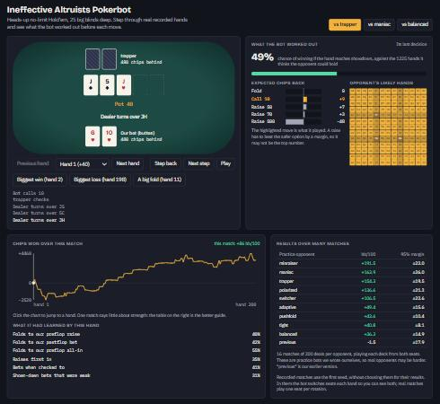

# Ineffective Altruists Pokerbot

Our entry for the [Pokerbot Challenge](https://github.com/Manchester-AI-Society/poker_bot)
at GreatUniHack 2026, run by MUDS AI: a Python bot for heads-up no-limit Texas
hold'em. It learns each opponent's habits during a match and exploits them. It
only plays in this competition's engine, not on real-money sites.

**[Watch the bot think: live demo](https://alexf0643.github.io/PokerBot/demo/)**

[](https://alexf0643.github.io/PokerBot/demo/)

## At a glance

| | |
|---|---|
| **The submission** | [`ineffective-altruists.pkl`](ineffective-altruists.pkl) and [`model.py`](model.py), which is all the bot needs alongside the organisers' engine |
| **Approach** | Simulates each decision and adapts to the opponent, with no pre-trained model |
| **Average result** | +92.1 big blinds per 100 hands against ten practice opponents ([details and caveats](#results)) |
| **Rule checks** | Passes the organisers' submission check with nothing flagged |
| **Organisers' instructions** | [`docs/organisers-guide.md`](docs/organisers-guide.md) |

## Try it

You need Python 3.10 or newer. These commands are for Windows. On macOS or Linux,
use `.venv/bin/` in place of `.venv\Scripts\`.

```sh
git clone https://github.com/AlexF0643/PokerBot.git
cd PokerBot
python -m venv .venv
.venv\Scripts\python -m pip install -r requirements-dev.txt
```

Play the bot against the organisers' dummy bots. This takes a few minutes:

```sh
.venv\Scripts\python -m evals --deals 100
```

To see the demo without installing anything, use the link above, or open
[`demo/index.html`](demo/index.html) from a downloaded copy.

## How the bot plays

At each decision, the bot estimates how many chips it would get back from
folding, calling and several raise sizes, then picks the best. A raise has to
beat the safer option by a margin that grows with its size. It also won't raise
all-in with under 30% equity against the hands it expects to call.

1. **Simulation:** it plays the hand out 600 times against the hands the
   opponent could hold. On the river it checks each of those hands once.
2. **Learning rates:** it counts how each opponent folds, calls, raises and
   shoves in each situation, starting from assumed rates that count for 14 hands.
3. **Narrowing the range:** it uses those rates to narrow down what the
   opponent holds after each move.
4. **Learning from showdowns:** it uses revealed cards to judge how often that
   opponent bluffs and slow-plays.

Any internal error falls back to a legal check or fold, so an error can't cause
a fault. The test suite runs the bot without this fallback, so bugs still show.

Strong poker research systems such as Libratus, Pluribus and DeepStack need far
more computing power than a one-day event allows. This bot aims to exploit the
habits of the bots it meets, and it doesn't try to play a near-perfect strategy.

## The competition

- Every bot plays every other bot heads-up, and the best overall bb/100 (big
  blinds won per 100 hands) wins.
- Every hand starts with 500 chips and 10/20 blinds, so 25 big blinds deep.
- Each deck is played from both seats. The bot is rebuilt from its pickle for
  each seat rotation, so it forgets what it learned between them.
- Each move has a 10 second limit. A crash, timeout or illegal move is a fault,
  and a bot that times out is out for the rest of that match.

## Results

These come from bots we wrote or the organisers' simple dummies, and we tuned
against the practice bots, so they probably flatter the bot. They don't predict
a tournament result. A result is only clear when its margin doesn't include 0.

Against the practice bots and `tight`, over 16 matches of 200 deals per opponent:

| Opponent | Style | bb/100 | 95% margin |
|---|---|---:|---:|
| `minraiser` | Min-raises and rarely folds | +191.5 | 22.0 |
| `maniac` | Constant large bluffs | +163.9 | 26.0 |
| `trapper` | Slow-plays strong hands, bets weak ones | +154.3 | 19.5 |
| `polarized` | Small bets with medium hands, shoves with its best and air | +136.6 | 21.2 |
| `switcher` | Tight for 60 hands, then a maniac | +106.5 | 22.6 |
| `adaptive` | Learns how often we fold and attacks it | +49.4 | 15.6 |
| `pushfold` | Shoves or folds preflop | +43.6 | 10.4 |
| `tight` | Organiser dummy that plays strong hands only | +40.8 | 8.1 |
| `balanced` | Sound ranges with steady bluffs | +36.3 | 14.9 |
| `previous` | Our earlier version | -1.5 | 17.9 |
| **Average** | | **+92.1** | |

Against the organisers' dummies, using `python -m evals --deals 300` (600 hands
each, with no faults):

| Opponent | bb/100 | 95% margin |
|---|---:|---:|
| `call` | +544.2 | 72.6 |
| `random` | +315.6 | 89.4 |
| `shove` | +254.2 | 94.5 |
| `equity` | +187.5 | 60.4 |
| `fold` | +74.7 | 0.7 |
| `tight` | +42.4 | 25.7 |

Known weaknesses:

- Earlier versions overrated postflop raises. For example, flop shoves against
  `balanced` were predicted at 147 chips and returned about 72. We haven't
  re-measured this since adding the all-in rule.
- It is level with its own earlier version, and only modestly ahead of `balanced`.
- The all-in rule costs chips against bots that raise at random: `random` fell
  from +392 (8 matches) to +318 (16 matches). We accepted this because the rule
  protects against selective callers like `balanced`.
- Overall strength barely changed in the last two rounds of tuning. The average
  went from +85.4 to +91.0 and then +92.1, too small a gain to prove statistically.

## What's in this repo

The organisers' engine has to sit in the top folder, so our files sit beside it.

**Our bot, which is what gets submitted:**

| File | What it is |
|---|---|
| [`model.py`](model.py) | The bot, including a hand evaluator about 45 times faster than the engine's and a table of starting-hand strengths |
| [`ineffective-altruists.pkl`](ineffective-altruists.pkl) | The bot object the organisers load, built from `model.py` |

**Our tools and tests, which aren't submitted:**

| File | What it does |
|---|---|
| [`demo/`](demo) | The demo page and its template |
| [`tools/sparring.py`](tools/sparring.py) | Nine practice bots in different styles |
| [`tools/spar.py`](tools/spar.py) | Plays the bot against the practice bots in the real format |
| [`tools/calibrate.py`](tools/calibrate.py) | Compares the value the bot predicts with what it wins |
| [`tools/record_demo.py`](tools/record_demo.py) | Records matches and builds the demo page |
| [`tools/build_preflop_table.py`](tools/build_preflop_table.py) | Recalculates the starting-hand table |
| [`tools/previous_model.py`](tools/previous_model.py) | A frozen earlier version of the bot to play against |
| [`tests/test_fast_eval.py`](tests/test_fast_eval.py) | Checks the evaluator against the engine's and known poker counts |
| [`tests/test_strategy.py`](tests/test_strategy.py) | Runs the bot without its safety fallback |

**From the organisers:** `arena/`, `evals/`, `engine.py`, `card_utils.py`,
`game_state.py`, `game_interface.py`, `player_action.py`, `submit.py`, `CLAUDE.md`,
the requirements files and the other tests. We haven't changed their code. Their
instructions are in [`docs/organisers-guide.md`](docs/organisers-guide.md), and
`CLAUDE.md` is from before their documentation update on the day.

## Checking and testing

Run these from the repo root:

```sh
# Is it a valid submission?
.venv\Scripts\python -m pytest tests/test_model.py -q

# Would the organisers accept it? This rebuilds the .pkl, so run it after any
# change to model.py and commit the result.
.venv\Scripts\python -m submit --team ineffective-altruists

# How does it do against the organisers' dummy bots?
.venv\Scripts\python -m evals

# How does it do against the tougher practice bots?
.venv\Scripts\python -m tools.spar --deals 200 --seeds 8

# How does it do against another team's bot? Their .py files must be importable.
.venv\Scripts\python -m evals --opponents path\to\their_bot.pkl --deals 1000

# Where is it leaking chips?
.venv\Scripts\python -m tools.calibrate balanced --seeds 8

# Rebuild the demo page after changing the bot.
.venv\Scripts\python -m tools.record_demo
```

## About the demo

The demo replays real recorded hands and shows what the bot worked out before
each move: its chance of winning, the chips it expected back from each option,
the opponent's likely hands and what it had learned so far. Use **Next step** or
the arrow keys to move through a hand, or **Play** to run hands automatically.

The recorded matches all use one fixed seed and weren't chosen for their results:
`trapper` +86.0, `maniac` +135.5 and `balanced` +3.0 bb/100. One match says little
about strength. The bot swaps seats every hand in these recordings so viewers see
both seats, whereas real matches play one seat per rotation.
